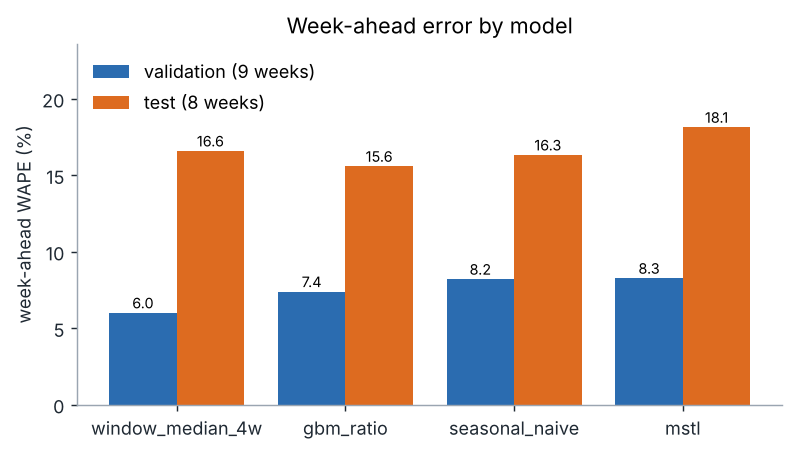
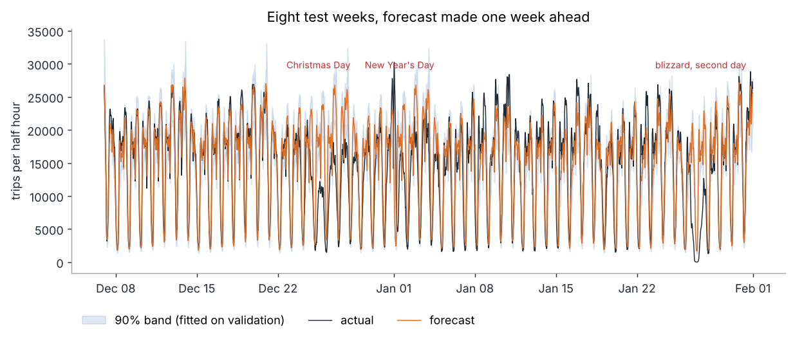
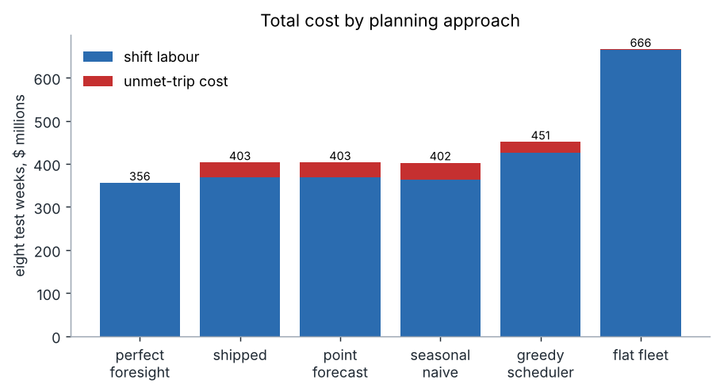
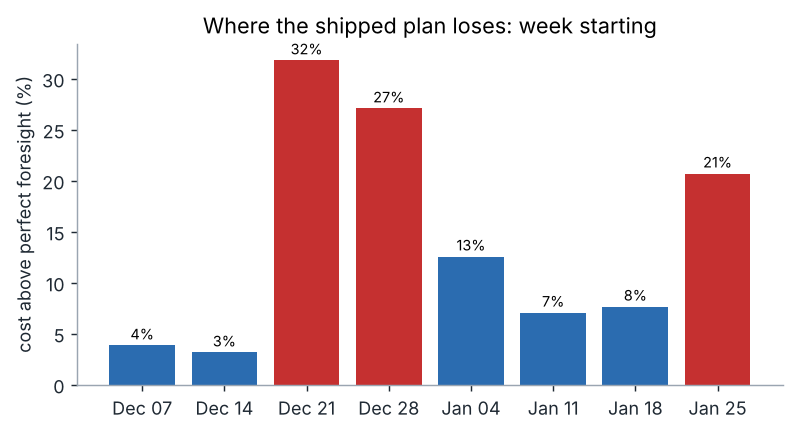
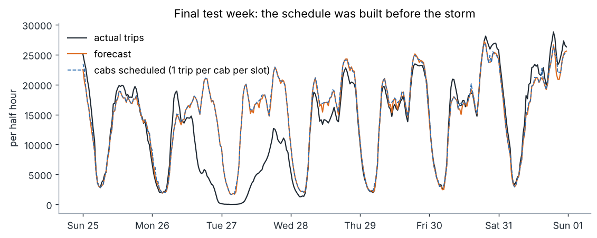
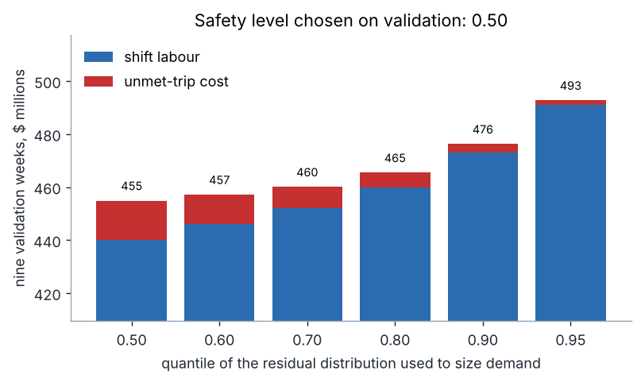
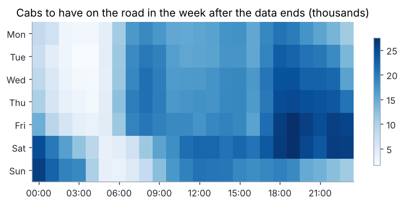

# shiftcast

[](https://github.com/ranjithguggilla/shiftcast/actions/workflows/ci.yml)

shiftcast forecasts a week of New York taxi demand, turns the forecast into a number of cabs needed in every half hour, and then asks a constraint solver for the cheapest set of driver shifts that covers it. The point of the project is the hand-off between the forecast and the schedule, because that is where a forecasting error becomes a dollar figure.

I built it to answer a narrow question: when a fleet plans a week ahead, how much does a better forecast actually matter compared with the scheduling method, and what does a week like Christmas or a blizzard cost?

## Results

Data is 10,320 half-hourly trip counts from 1 July 2014 to 31 January 2015. Models were chosen on nine validation weeks (5 Oct to 6 Dec) and scored once on eight untouched test weeks (7 Dec to 31 Jan), which contain Christmas, New Year, MLK Day and the January 2015 blizzard. Every forecast is made a full week ahead, from history that ends before the week starts.

### Forecast accuracy (WAPE, lower is better)

| model | validation | test |
|---|---|---|
| window median, 4 weeks (shipped) | 5.99% | 16.58% |
| gradient boosting on log ratio | 7.38% | 15.57% |
| seasonal naive (same slot last week) | 8.19% | 16.31% |
| MSTL, daily + weekly seasonality | 8.25% | 18.13% |

The simplest serious model won validation, so it ships. Boosting happened to do better on the test weeks, but the paired bootstrap over test weeks puts the gap (window median minus boosting) at +1.0 points with a 95% interval of -0.3 to +2.5, which includes zero. The shipped model is not separable from any of the other three on eight weeks (the intervals for its gap to seasonal naive and to MSTL also straddle zero), and I would not claim otherwise.





On ordinary days the shipped model's daily total is off by a median of 6.5%. On the days nobody could have forecast from the history it had, it is off by a lot:

| day | signed error of daily total |
|---|---|
| Christmas Eve | +22.7% |
| Christmas Day | +102.3% |
| New Year's Eve | +3.7% |
| New Year's Day | +10.8% |
| MLK Day | +8.9% |
| blizzard, first day | +59.8% |
| blizzard, second day | +190.2% |

### Prediction intervals

I fitted multiplicative residual quantiles by part of the day on the validation weeks. They do not hold up on the test period: a nominal 90% interval covered 60.5% of test slots (65.1% on ordinary days, 28.0% on the seven event days above), and the nominal 80% interval covered 42.4%. The validation weeks were calmer than the test weeks, so the residuals it learned were too narrow. I kept the intervals because the safety margin in the staffing step is built from them, and because the failure is informative: a calibration window has to contain the kind of weeks you will be scored on.

### Scheduling and cost

Costs below are for the eight test weeks, 38.9 million trips, under the assumptions listed further down (a cab-half-hour costs $9, an unmet trip costs $15, one cab handles one trip per half hour).

| plan | labour | unmet-trip cost | total | service level |
|---|---|---|---|---|
| perfect foresight (lower bound) | $355.7M | $0.0M | $355.7M | 100.0% |
| shipped: window median, solver | $368.7M | $34.2M | $402.9M | 94.1% |
| point forecast, solver | $369.5M | $33.5M | $403.0M | 94.3% |
| seasonal naive, solver | $363.7M | $38.7M | $402.4M | 93.4% |
| greedy scheduler on the shipped demand | $425.5M | $25.2M | $450.6M | 95.7% |
| flat fleet sized to last week's peak | $665.3M | $0.4M | $665.7M | 99.9% |



Three things stand out.

The solver matters far more than the forecast. Swapping the greedy shift builder for CP-SAT cuts total cost by $47.7M (10.6%), and the flat fleet costs $262.8M more than the shipped plan. Swapping the forecast model moves cost by about 0.1%. CP-SAT solved every weekly problem to proven optimality in a median of 0.28 seconds.

At my base assumptions the forecast model did not pay for itself. The shipped plan costs $0.5M more than the seasonal-naive plan over the eight weeks. It starts to win only when an unmet trip is expensive. I re-picked the safety level on validation for each penalty and priced the test weeks:

| unmet-trip cost | safety level picked | shipped | seasonal naive | difference |
|---|---|---|---|---|
| $8 | 0.50 | $386.9M | $384.3M | -$2.6M |
| $15 | 0.50 | $402.9M | $402.4M | -$0.5M |
| $25 | 0.60 | $424.3M | $428.2M | +$3.8M |
| $40 | 0.70 | $451.2M | $466.8M | +$15.7M |

The shipped plan sits 13.3% above perfect foresight, which is $47.2M over the eight weeks. Almost all of that comes from three weeks:



The weeks starting 21 Dec and 28 Dec (Christmas, New Year) and 25 Jan (blizzard) run 31.8%, 27.1% and 20.7% above the lower bound. The other five weeks sit between 3.1% and 12.5%. In the storm week the schedule was fixed before the storm, so it staffed for demand that never arrived: the two storm days came in far below forecast and the plan could not shrink.





The plan for the week after the data ends peaks at 27,463 cabs on the road:



The safety level came out at 0.50 on validation, which means no extra margin beyond the median residual correction. With an overage cost of $9 and an underage cost of $15 the textbook newsvendor answer is the 0.625 quantile. Validation picked a little lower, but the curve is nearly flat: 0.60 costs 0.5% more than 0.50 and 0.70 costs 1.1% more.

## Architecture

```
 nyc_taxi.csv (30 min counts)
        |
        v
 +--------------+    +--------------------+    +-------------------+
 |  data.py     |--->|  models.py         |--->|  backtest.py      |
 |  grid checks |    |  naive / median /  |    |  9 val + 8 test   |
 |  week blocks |    |  MSTL / boosting   |    |  weekly origins   |
 +--------------+    +--------------------+    +---------+---------+
                                                         |
                                  chosen model + residuals
                                                         v
 +--------------+    +--------------------+    +-------------------+
 | service.py   |<---|  planner.py        |<---|  intervals.py     |
 | Gradio UI    |    |  forecast -> cabs  |    |  residual         |
 +--------------+    |  -> CP-SAT shifts  |    |  quantiles by     |
                     +---------+----------+    |  part of day      |
                               |               +-------------------+
                               v
                     +--------------------+
                     |  staffing.py       |
                     |  CP-SAT, greedy,   |
                     |  flat, evaluation  |
                     +--------------------+
```

## Installation

Python 3.11 or newer.

```bash
git clone https://github.com/ranjithguggilla/shiftcast.git
cd shiftcast
python -m venv .venv && source .venv/bin/activate
pip install -r requirements.txt
pip install -e . --no-deps
```

The trip counts ship in `data/`, so there is nothing to download.

## Usage

Run the whole study (about two minutes on a laptop):

```bash
python -m shiftcast.pipeline --out outputs --assets assets
```

That backtests the four models, picks one by the validation rule, fits the interval calibrator, builds and solves the weekly schedules for every strategy, writes the metrics and refreshes the charts. Add `--quick` for a smoke run with fewer safety levels.

Open the planner:

```bash
python -m shiftcast.app
```

Pick one of the eight test weeks or the week after the data ends, move the sliders for the safety level and the cost assumptions, and press Plan. The text box reports peak cabs, labour cost, shifts started, and, for weeks with actuals, unmet trips and service level.

From Python:

```python
from shiftcast.service import Planner
from shiftcast.staffing import CostModel

planner = Planner()
res = planner.score_week("2015-01-25", level=0.7, cost=CostModel(unmet_trip_cost=25))
print(res["summary"])
res["frame"].head()
```

## Configuration

Costs live in `shiftcast.staffing.CostModel`:

| field | default | meaning |
|---|---|---|
| `trips_per_cab_slot` | 1.0 | trips one working cab completes per half hour |
| `cab_slot_cost` | 9.0 | dollars to keep a cab on the road for 30 minutes |
| `unmet_trip_cost` | 15.0 | dollars lost per trip nobody can take |
| `shifts` | 8h at 1.00, 10h at 1.00, 4h at 1.15 | length in half hours and a cost multiplier per slot |

None of these come from the data. They are placeholders chosen to be plausible, and the sensitivity table above shows how much the conclusion depends on the unmet-trip cost. Replace them with real figures before using any dollar number for a decision.

The study constants (nine validation weeks, eight test weeks, the safety levels tried, the 0.003 WAPE tolerance for preferring a simpler model) are at the top of `pipeline.py`.

## Output structure

```
outputs/
  metrics.json         every number quoted in this README
  backtest.csv         actual and forecast per model, per slot, per week
  test_forecasts.csv   shipped model with the 90% band, test weeks only
  next_week_plan.csv   forecast, sized demand and cabs for the week after the data
  charts/              figures (written to assets/ when --assets assets is used)
```

## Project structure

```
src/shiftcast/
  data.py        load, grid validation, end-aligned week blocks
  calendar.py    slot, weekday and holiday features
  models.py      seasonal naive, window median, MSTL, boosting on a log ratio
  backtest.py    weekly rolling origin, WAPE, bias, paired block bootstrap
  intervals.py   residual quantiles by part of the day
  staffing.py    CP-SAT scheduler, greedy baseline, flat fleet, cost evaluation
  planner.py     forecast a week, size it, schedule it
  pipeline.py    the full study
  service.py     scoring function and Gradio app
  charts.py      figures
tests/           unit tests plus one end-to-end run on a synthetic series
data/            nyc_taxi.csv and the licence of its source repository
assets/          charts used in this file
```

## Technical details

Forecast horizon. A plan has to be committed a week ahead, so every model sees only history that ends before the week begins. That rules out the day-ahead lags that most taxi-demand tutorials use. The boosting model predicts the log ratio between a slot and the mean of the same slot over the previous four weeks, using slot, weekday, a holiday flag, and holiday flags for the lag weeks. The level comes from recent weeks and the model only has to learn shape.

Holidays. The flag covers US federal and New York holidays plus half weight on a holiday's eve. The training period contains Independence Day, Labor Day, Columbus Day, Veterans Day and Thanksgiving, so Christmas and New Year are effectively new to every model.

Intervals. For each part of the day (00:00 to 06:00, 06:00 to 10:00, 10:00 to 19:00, 19:00 to 24:00) the calibrator keeps the sorted log residuals from validation and reads off a finite-sample corrected quantile. Sizing demand at level q means multiplying the forecast by the exponential of that quantile.

Scheduling. The week is treated as a cycle of 336 half-hour slots. For each shift length there is an integer variable per start slot, each slot must be covered by at least the required number of cabs, and the objective is shift cost in cents. Wrapping the week onto itself keeps the plan steady-state, so a shift that starts late on Saturday carries into Sunday morning. The greedy baseline walks the week once and starts full-length shifts wherever coverage is short.

Evaluation. A schedule delivers a cab count per slot. Served trips are the smaller of actual demand and cabs times the service rate, the rest is unmet. Labour is the price the solver paid for the schedule.

Limits. The data is one city's aggregate for seven months, so there is only one Christmas and one blizzard. Demand in the model is exogenous, so a surge in price or a driver shortage does not feed back into it. A cab is assumed to serve one trip per half hour wherever it is, with no repositioning cost. The fleet scale is whatever the aggregate counts imply and is not the real medallion fleet.

## Testing

```bash
pip install pytest pytest-cov ruff
ruff check src tests
pytest -q --cov=shiftcast
```

37 tests pass locally with 93% line coverage, and ruff is clean. The suite checks the grid validation, that no forecaster reads the future, that the window median resists a wild week, interval coverage on exchangeable noise, that the solver is optimal and feasible and never costs more than the greedy plan, and a full pipeline run on a synthetic 24-week series. CI runs lint and tests on every push, and on main it also runs the full pipeline and uploads `outputs/` as an artifact.

## Dataset

Half-hourly New York City taxi trip counts, from the Numenta Anomaly Benchmark: `data/realKnownCause/nyc_taxi.csv` in https://github.com/numenta/NAB (commit ea702d75). The counts derive from the NYC Taxi and Limousine Commission trip records. NAB is distributed under the AGPL-3.0 licence, which is kept next to the file in `data/NAB_LICENSE.txt`; the code in this repository is MIT.

## License

MIT, copyright Ranjith Guggilla. See `LICENSE`.
